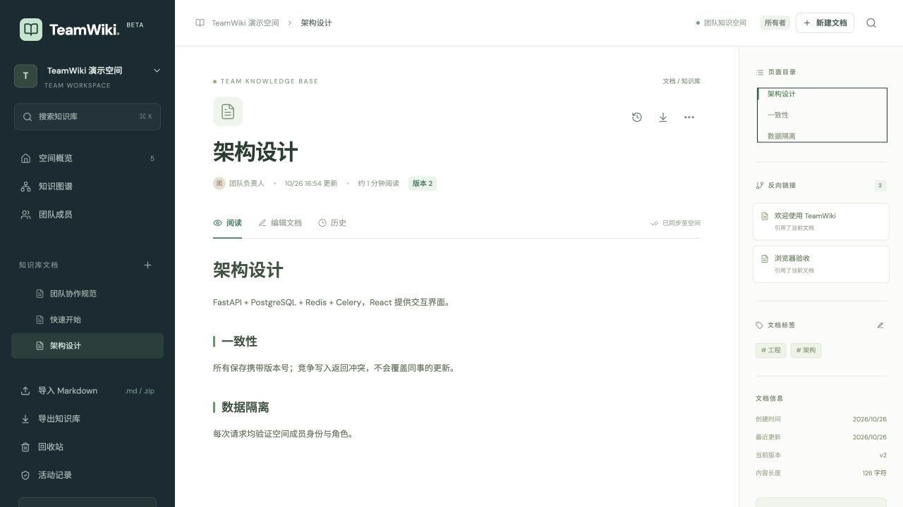

# TeamWiki

TeamWiki 是面向小团队的协作知识库，帮助团队把零散的 Markdown 文档、项目决策和经验整理成可查找、可追溯的知识网络。它也是一个可运行的 Python 全栈项目，重点展示租户隔离、并发写入一致性和后台任务可靠性。

技术栈：Python 3.12、FastAPI、SQLAlchemy 2.0 异步 ORM、PostgreSQL 17、Redis 7、Celery、React、TypeScript、CodeMirror、Tailwind CSS、Cytoscape 与 Prometheus Client。

当前版本 **0.2.0**：已实际构建并启动 Docker Compose；默认两个 API 进程、独立缓存和任务队列 Redis、有界连接池，以及普通文档保存的共享锁和来源页面增量链接索引。推荐方案、对照基准和容量边界见 [并发方案](docs/concurrency.md)，容器启动与运维见 [Docker 交付](docs/docker.md)。



## 快速启动

需要 Docker 与 Compose。在项目根目录执行：

```bash
cp .env.example .env
# 修改 POSTGRES_PASSWORD、DATABASE_URL 中的对应密码和 JWT_SECRET。
docker compose up --build -d --wait --wait-timeout 180
python3 scripts/seed.py --url http://localhost:8080
```

打开 <http://localhost:8080>。本机便携Docker运行时可用 `./work/docker-runtime/with-docker.sh` 替代 `docker`，状态及重启方法见 [Docker运行时](docs/docker.md#本次机器上的持久-docker-运行时)。迁移服务成功后，API、Worker、Beat 才会启动。详细原生开发步骤见 [运行与维护](docs/operations.md)。生产入口须配置 HTTPS，并设置 `ENVIRONMENT=production`、足够长的随机 JWT 密钥和精确的 `ALLOWED_ORIGINS`。

| 演示账户 | 角色 | 默认密码 |
| --- | --- | --- |
| owner@teamwiki.dev | 负责人 | DemoPassword123! |
| admin@teamwiki.dev | 管理员 | DemoPassword123! |
| editor@teamwiki.dev | 编辑 | DemoPassword123! |
| viewer@teamwiki.dev | 访客 | DemoPassword123! |

演示数据脚本使用公开 API，重复执行会复用账户、空间及已有样例文档；可用 `SEED_PASSWORD` 覆盖默认密码。脚本创建四篇原始中文样例文档，本次浏览器验收还创建了一篇测试页面。

交互式 API 文档：<http://localhost:8080/api/docs>；OpenAPI：<http://localhost:8080/api/openapi.json>。仓库中的 [OpenAPI 快照](docs/openapi.json) 来自最终运行中的 API。

## 分阶段功能与状态

| 阶段 | 已实现内容 | 验证状态 |
| --- | --- | --- |
| Phase 1：可用知识库 | 注册、登录、撤销会话；多工作区与四级角色；邮箱绑定邀请；页面树、Markdown 编辑/预览、标签、软删除和恢复 | 已实现，真实 PostgreSQL HTTP 测试及浏览器流程验证 |
| Phase 2：协作与知识关联 | 版本条件更新和 409 冲突；完整修订快照与历史恢复；标题/固定 ID 链接、反向链接、图谱；全文搜索和版本缓存 | 已实现，并发保存、租户边界、链接身份、缓存故障/旧版本回填均有验证 |
| Phase 3：可靠导入与交付 | 有界 Markdown/ZIP 导入；事务 Outbox、Celery 幂等消费与滞留恢复；审计、导出；迁移、种子数据、Locust、Compose 和 CI 配置 | 已实现，真实 Redis/Worker/Beat 链路、重复投递及 Docker 完整容器联调通过；远程 CI 的后端、前端与完整 Compose 三项任务通过 |

所有空间成员都能阅读该空间的全部页面；editor 及以上可写；admin/owner 可管理导入和查看审计。只有 owner 能管理 admin，owner 不能被移除或降级。邀请 token 绑定邮箱、有效期和单次使用状态，用户自行分享邀请链接。

## 技术选择

| 组件 | 选择原因 |
| --- | --- |
| FastAPI / Pydantic | 清晰的请求验证、异步 HTTP 接口及自动 OpenAPI 文档 |
| SQLAlchemy 2.0 async / asyncpg | 用数据库事务组织业务，明确表达条件更新、行锁与租户过滤 |
| PostgreSQL | 外键和唯一约束兜住边界；GIN 全文索引支持检索；真实行锁支持并发验证 |
| Redis | 独立实例承载可淘汰页面缓存与持久化、不可淘汰的任务队列；数据库仍是权限、版本和任务状态的权威来源 |
| Celery / Beat / Outbox | 把耗时导入移出请求，使发布失败、重复投递和丢失消费可以恢复 |
| React / TanStack Query / CodeMirror | 编辑、预览、草稿和冲突处理，集中管理服务端查询状态 |
| react-markdown / Cytoscape | 安全 Markdown 呈现与知识关系图，不启用原始 HTML 渲染 |
| Prometheus Client | 提供请求延迟、状态、缓存命令结果、过载拒绝与数据库容量错误指标；聚合容器内多个 API 进程，指标接口只在私有网络访问 |

系统采用模块化单体，API 与 Worker 共享服务函数和模型，降低部署和事务边界的复杂度。空间内写入量较大时，可根据测量再拆分任务或索引服务。架构图见 [架构与一致性](docs/architecture.md)。

## 主要模型

| 模型 | 职责 |
| --- | --- |
| User / AuthSession | Argon2 密码、带到期和撤销状态的 JWT 会话 |
| Workspace / WorkspaceMember / Invitation | 空间、成员角色、哈希邀请 token |
| Page / PageRevision | 当前页面与每次成功修改后的完整快照 |
| PageLink | 来源、目标 ID、原始目标、解析状态及来源版本 |
| ImportJob / OutboxEvent | 幂等上传、校验后的内容、任务状态与可靠投递记录 |
| AuditLog | 操作者、动作、实体和时间 |

业务 ID 使用 UUID 字符串。页面父节点、修订所属页和链接两端都通过包含 `workspace_id` 的复合外键约束在同一空间内。唯一约束保护成员、页面版本、上传幂等键和导入项目。完整字段、索引及 ER 图见 [数据模型](docs/data-model.md)。

## API 示例

以下使用本地 Compose 地址。需要 `curl`；先从响应中复制工作区和页面的真实 UUID，再替换标注的占位值。Cookie 保存于当前目录的 `cookies.txt`。

```bash
BASE='http://localhost:8080'

# 注册并取得 HttpOnly 会话 Cookie。
curl -i -c cookies.txt -X POST "$BASE/api/auth/register" \
  -H 'Content-Type: application/json' \
  -d '{"email":"curl-demo@example.com","password":"DemoPassword123!","name":"API 演示"}'

# 已注册账户可通过 /api/auth/login 提交 email/password 登录。
curl -b cookies.txt -X POST "$BASE/api/workspaces" \
  -H 'Content-Type: application/json' -d '{"name":"API 演示空间"}'

WID='替换为上一步响应的真实工作区 UUID'
curl -b cookies.txt -X POST "$BASE/api/workspaces/$WID/pages" \
  -H 'Content-Type: application/json' \
  -d '{"title":"第一篇文档","content":"# Hello TeamWiki","tags":["入门"]}'

PID='替换为创建页面响应的真实页面 UUID'

# 新页面 version=1；成功后响应 version=2。
curl -b cookies.txt -X PATCH "$BASE/api/workspaces/$WID/pages/$PID" \
  -H 'Content-Type: application/json' \
  -d '{"version":1,"content":"# 已更新\n\n一次成功的保存。"}'

# 再提交旧 version=1，预期 HTTP 409。
curl -i -b cookies.txt -X PATCH "$BASE/api/workspaces/$WID/pages/$PID" \
  -H 'Content-Type: application/json' \
  -d '{"version":1,"content":"这份旧草稿不会覆盖服务器版本"}'
```

409 响应的 `detail` 包含 `code: version_conflict`、`current` 和 `submitted_version`。客户端保留草稿，允许查看/加载当前服务器版本，没有静默覆盖。

```bash
# 查看历史；按上述顺序，此时当前版本为 2。
curl -b cookies.txt "$BASE/api/workspaces/$WID/pages/$PID/revisions"

# 把历史版本 1 恢复为新的版本 3，仍须提交当前 version=2。
curl -b cookies.txt -X POST \
  "$BASE/api/workspaces/$WID/pages/$PID/revisions/1/restore" \
  -H 'Content-Type: application/json' -d '{"version":2}'

# 相同空间、相同幂等键和相同文件重复提交，返回同一个导入任务。
# ./notes.md 是自己准备的 UTF-8 Markdown 文件。
curl -b cookies.txt -X POST "$BASE/api/workspaces/$WID/imports" \
  -H 'Idempotency-Key: curl-import-example-001' -F 'file=@./notes.md'

JOB='替换为上传响应的真实任务 UUID'
curl -b cookies.txt "$BASE/api/workspaces/$WID/imports/$JOB"

# 搜索与导出。
curl -b cookies.txt "$BASE/api/workspaces/$WID/search?q=TeamWiki"
curl -b cookies.txt "$BASE/api/workspaces/$WID/pages/$PID/export" -o page.md
curl -b cookies.txt "$BASE/api/workspaces/$WID/export" -o workspace.zip
```

上传返回 HTTP 202；Worker 和 Beat 必须运行才能完成导入。同一幂等键改传不同内容返回 409。各页面请求、修订、搜索、图谱、任务状态和导出都重新验证空间成员身份。

## 一致性与可靠性的关键取舍

- **版本竞争**：每次修改使用数据库条件更新，同一旧版本只有一个请求成功；修改、修订、链接和审计位于同一事务，提交失败会返回错误。
- **锁粒度**：普通正文和标签保存取得空间共享锁，不同文档可以并行；实际重命名、移动、创建、删除、恢复及成员变更仍取得排他锁。锁后重新鉴权，统一保持空间→任务/页面的锁顺序，避免死锁和权限撤销竞态。
- **链接身份**：`[[标题]]` 在重名时标记 ambiguous，缺失时标记 unresolved；已解析引用绑定目标 ID，重命名不会改指其他页面。也支持 `[[id:UUID|标签]]`。普通保存只解析和重建当前来源页面；结构变更和批量导入仍在排他锁下全量校正。普通保存查询整个空间的目标元数据，但不读取、解析其他页面正文。
- **缓存**：先从 PostgreSQL 验证成员、当前版本和删除状态，再查 `tw:{空间}:page:{页面}:v:{版本}`。旧请求即使晚到并回填旧键，也不会成为后续读取的新版本。Redis 连接/读写短超时，失败回退数据库；TTL 为 300 秒加 0–30 秒抖动。
- **连接与过载**：默认两个 API 进程，每进程数据库池 5 个常驻、5 个溢出，API 合计最多 20 个数据库连接；Redis 池复用连接。达到在途上限、连接池耗尽、锁/语句超时或数据库暂时不可用时返回 503 和 Retry-After；程序及 SQL 错误仍作为 500 暴露。
- **导入**：API 同事务写 Job 和 Outbox；Dispatcher 只有在 broker 发布成功后才标记已发送。崩溃可能重复投递，因此 Worker 用任务状态、行锁和唯一导入项目键实现幂等。Beat 每 5 秒派发 Outbox、每 60 秒检查滞留任务，默认 5 分钟阈值。

## 测试与实际结果

安装固定开发依赖后，在独立 PostgreSQL 测试库运行：

```bash
python3.12 -m venv .venv
.venv/bin/pip install -r backend/requirements-dev.lock
.venv/bin/pip install --no-deps -e ./backend
export TEST_DATABASE_URL='postgresql+asyncpg://用户:密码@127.0.0.1:5432/teamwiki_test'
export REDIS_URL='redis://127.0.0.1:6379/0'
cd backend
DATABASE_URL="$TEST_DATABASE_URL" ../.venv/bin/alembic upgrade head
../.venv/bin/pytest -q
```

测试会清空测试库业务表，须使用独立库。PostgreSQL 测试保留迁移后的模式；SQLite 只用于隔离测试回退，不作为支持的部署数据库。

```bash
# 在 frontend/ 中执行：
npm ci
npm test
npm run build

# 在项目根目录启动 API 并 seed 后执行：
.venv/bin/locust -f scripts/locustfile.py --headless -u 10 -r 2 -t 30s \
  --host http://localhost:8000 --csv work/locust
```

本次已确认：

- 真实 PostgreSQL 后端测试 **77 项通过**，覆盖权限/IDOR、会话撤销、原子保存/恢复、并发竞争、链接、缓存、危险 ZIP 和可靠导入。
- 显式 Alembic `upgrade → downgrade → upgrade` 通过，系统目录确认生成全文列、GIN 索引和复合外键。
- 真实 Redis 缓存填充、旧键驱逐、延迟旧键回填以及删除后拒绝缓存读取通过。
- API → Outbox → Redis → Celery Worker/Beat 导入通过；重复请求和两次重复任务投递仍只有一篇导入页。
- 10 用户短时 Locust 检查完成 **991 请求、0 失败**，其中明确验证了 103 次预期 409。小样例、本机单进程结果不能作为生产容量承诺。
- 20,000 篇合成页面上的实际搜索计划自然使用 GIN，此次完整字段查询执行约 0.107 ms。

已通过本机 ARM64 Docker 引擎实际构建、启动完整容器栈，验证前端、迁移、两进程 API、Celery 导入、版本冲突、租户隔离、缓存中断降级和队列重启恢复。CI 增加完整 Compose 构建/启动/冒烟检查；首次远程 GitHub Actions 三项任务均通过（[公开运行记录](https://github.com/chen9zz/teamwiki/actions/runs/40275391284)）：后端 77 项测试、前端 13 项测试及编译产物回归、AMD64 完整 Compose 构建/启动/冒烟与异步导入。前端13项测试、类型检查和生产构建通过，新增实际编译产物的文档→CodeMirror→预览回归，并纳入镜像构建和CI。

在相同原生环境、两个 API 进程、100篇固定小文档、16个请求流、每场景10秒的对照中，不同文档保存从136.390提升至764.940请求/秒，P95从138.778降至32.144毫秒；读取从738.892至753.711请求/秒。热点每批仍为一个成功、十五个409，历史连续。它只说明本次短测下的常规保存改善，不代表线上容量、长文档或长期稳定性。原始JSON及完整限制见 [并发验证](docs/concurrency.md)。

首版与升级验证、原始摘要和环境条件见 [实际验证记录](docs/verification.md)。

## 明确的边界

- 权限粒度为工作区，所有成员可读全部页面；没有每页 ACL、SSO 或公开匿名分享。
- 邀请由用户自行分享，不发送邮件；没有实时 CRDT、多人光标或自动内容合并。
- `simple` 全文搜索不做中文分词、语义理解或向量检索，连续中文文本的搜索能力受词元边界限制。
- 普通文档保存可以并行，但结构和权限变更仍在空间粒度串行协调；目标目录元数据查询仍随空间大小增长。下一步应测量大空间和结构密集写入，再决定目标索引、异步链接协议或更细锁粒度。
- 导入是有界原子事务：上传最多 8 MiB、单文件最多 2 MiB、最多 200 个 Markdown 文件、展开最多 16 MiB，压缩比最多 100；拒绝危险路径、重复路径、符号链接、加密包和非 UTF-8。对外进度通常从 queued/0 直接到 completed/N，不保证可见的逐文件实时进度。
- 单篇正文最多 1,000,000 字符，每页最多 24 个标签。删除有子页面的页面前须先移动或删除子页面。
- 历史接口默认返回最新 200 条修订，可用 `offset` 分页；页面列表默认最多 5,000 项，搜索默认 50 项。前端不会无限加载所有历史。
- 导出是正文 Markdown，不是完整数据库备份；ZIP 不包含成员、审计、历史和所有页面元数据。空间导出最多 2,000 页或 32 MiB 正文，完整备份须使用 `pg_dump`。

## 项目结构与文档

```text
backend/app/                API、业务服务、模型、缓存和异步任务
backend/migrations/         显式 Alembic 迁移
backend/tests/              HTTP、事务和安全行为测试
backend/requirements*.lock  固定运行与开发依赖
frontend/src/               React 编辑器、预览、冲突处理、图谱与管理界面
infra/                      Nginx 与前端构建镜像
scripts/                    API 演示数据、Locust、EXPLAIN
docs/                       架构、数据模型、运维、OpenAPI 和验证证据
docker-compose.yml          postgres / redis-cache / redis-broker / migrate / api / worker / beat / frontend
```

- [架构与一致性](docs/architecture.md)
- [数据模型与 ER 图](docs/data-model.md)
- [运行、环境变量、迁移与备份](docs/operations.md)
- [实际验证记录与原始摘要](docs/verification.md)
- [Docker 部署、资源与连接预算](docs/docker.md)
- [推荐并发方案与对照基准](docs/concurrency.md)

## 可选的 Phase 4

后续可按真实需求增加邮件邀请、SSO、页面级权限、中文分词、结构变更的增量索引、对象存储附件和更细的异步任务可观测性；这些尚未实现。是否引入实时协同或拆分服务，应依据团队使用规模和测量结果决定。
