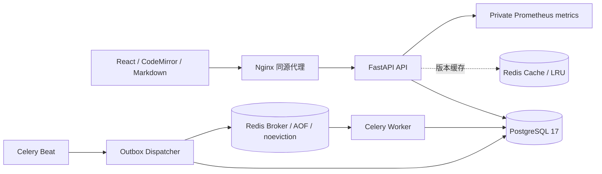

# 架构与一致性

TeamWiki 是模块化单体：API 与 Celery Worker 共享业务服务和 PostgreSQL 数据库；React 客户端通过同源 `/api` 访问后端。默认部署只开放 Nginx 的本机 8080 端口，PostgreSQL、Redis 和 API 留在 Compose 内部网络。

## 租户边界与会话

空间成员身份由数据库决定。每个空间请求先按 `workspace_id + user_id` 验证成员和角色；页面读取也验证所属空间，不能通过伪造页面、父节点、链接或导入任务 ID 跨空间访问。父页面、修订记录以及链接的数据库外键包含空间 ID，提供第二层边界。

密码使用 Argon2 哈希。JWT 放在 HttpOnly、SameSite=Lax Cookie 中，JWT 的会话 ID 还须命中数据库中未撤销、未过期的会话。登出撤销会话；旧 Cookie 不能继续访问。生产环境强制 Secure Cookie，写请求验证浏览器 Origin 与 Fetch Metadata。

## 页面写入

页面携带从 1 开始的 `version`。更新、删除、恢复和历史回滚均使用条件更新 `WHERE id = ? AND workspace_id = ? AND version = ?`；只有一个请求能将同一版本更新成功。失败返回 409，并附当前页面和提交版本。成功操作在同一个事务内写入完整修订快照、审计事件和链接索引。

普通正文及标签保存持有空间共享行锁，不同页面可以并行；创建、实际重命名、移动、删除、恢复及权限变更持有排他行锁。锁后重新检查成员权限，并按页面版本执行原子条件更新。普通保存只替换当前来源的链接，不解析其他页面正文；结构变更及批量导入仍全量校正，保持同步强一致性。详见 [并发方案](concurrency.md)。

## 链接与搜索

`[[标题]]` 按同空间活跃页面标题解析；找不到时为 unresolved，重名时为 ambiguous。`[[id:UUID|标签]]` 可精确引用。已解析链接绑定目标 ID，目标重命名、删除、恢复不会悄悄指向另一个同名页面。

PostgreSQL 的 `search_vector` 是存储生成列：标题权重 A、正文权重 B，使用 `simple` 配置和 GIN 索引。查询同时限制空间和未删除状态，再按相关度排序。`simple` 不包含中文分词，中文连续文本适合精确词元匹配；生产中文搜索可进一步引入专用分词扩展。`scripts/explain_search.py` 用实际查询展示执行计划，数据量很小时 PostgreSQL 合理选择顺序扫描。

## Redis 缓存

缓存键含空间、页面及版本：`tw:{workspace}:page:{page}:v:{version}`。读取先从数据库验证成员与当前版本，再读对应版本缓存，防止旧请求回填覆盖新版本。缓存带过期时间与抖动，超时/故障回退数据库。缓存不是权限来源，也不是页面版本的权威来源。

## 可靠导入

上传校验后的 Markdown 项目作为 JSON 存在 ImportJob。API 在同一个数据库事务中创建 Job 和 OutboxEvent。Beat 周期触发 Dispatcher；Dispatcher 发布到 Redis broker，成功后标记发布。发布与数据库确认之间的崩溃可能造成重复投递，因此 Worker 必须幂等。

Worker 加锁导入任务，重新检查执行者权限，并在一个事务内创建页面、修订、链接及完成状态。`(import_job_id, import_item_key)` 唯一约束和 completed 状态检查共同阻止重复创建。周期恢复任务重新投递滞留作业。无需引入分布式事务。

v0.3先按目录深度创建任务专属目录页，再创建Markdown子页；目录键`dir:规范路径`和文件路径均受唯一约束。目录不计入任务的文件进度，所有生成页仍保持原子提交。目录树/摘要通过元数据分页接口加载，不为导航读取整个空间正文。历史预览单独按当前空间元数据解析链接，不写关系索引；详细规则见[v0.3](v0.3.md)。

## 当前边界

编辑冲突采用版本提示和草稿保留，不提供实时多人光标或 CRDT 合并。附件对象存储、邮件邀请投递、SSO、多区域部署和完整中文分词不在本项目范围。邀请 token 在界面中生成后由用户自行分享。

