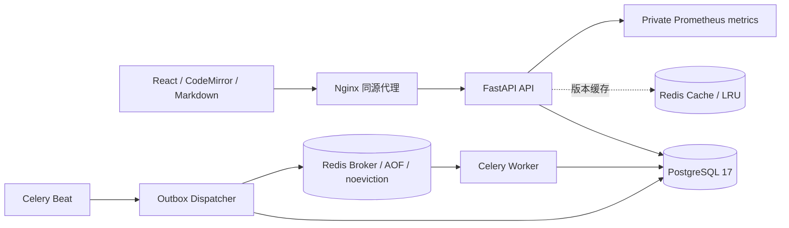

# 架构与一致性

TeamWiki 是模块化单体：API 与 Celery Worker 共享业务服务和 PostgreSQL 数据库；React 客户端通过同源 `/api` 访问后端。默认部署只开放 Nginx 的本机 8080 端口，PostgreSQL、Redis 和 API 留在 Compose 内部网络。

## 租户边界与会话

空间成员身份由数据库决定。每个空间请求先按 `workspace_id + user_id` 验证成员和角色；页面读取也验证所属空间，不能通过伪造页面、父节点、链接或导入任务 ID 跨空间访问。父页面、修订记录以及链接的数据库外键包含空间 ID，提供第二层边界。

密码使用 Argon2 哈希。JWT 放在 HttpOnly、SameSite=Lax Cookie 中，JWT 的会话 ID 还须命中数据库中未撤销、未过期的会话。登出撤销会话；旧 Cookie 不能继续访问。生产环境强制 Secure Cookie，写请求验证浏览器 Origin 与 Fetch Metadata。

## 页面写入

页面携带从 1 开始的 `version`。更新、删除、恢复和历史回滚均使用条件更新 `WHERE id = ? AND workspace_id = ? AND version = ?`；只有一个请求能将同一版本更新成功。失败返回 409，并附当前页面和提交版本。成功操作在同一个事务内写入完整修订快照、审计事件、链接索引和搜索分词字段，提交失败会一起回滚。

普通正文及标签保存持有空间共享行锁，不同页面可以并行；创建、实际重命名、移动、删除、恢复及权限变更持有排他行锁。锁后重新检查成员权限，并按页面版本执行原子条件更新。普通保存只替换当前来源的链接，不解析其他页面正文；结构变更及批量导入仍全量校正，保持同步强一致性。详见 [并发方案](concurrency.md)。

## 链接与搜索

`[[标题]]` 按同空间活跃页面标题解析；找不到时为 unresolved，重名时为 ambiguous。`[[id:UUID|标签]]` 可精确引用。已解析链接绑定目标 ID，目标重命名、删除、恢复不会悄悄指向另一个同名页面。

v0.4 保留原有英文 `search_vector` 和 `websearch_to_tsquery` 行为；含汉字的中文或中英混合查询改用 jieba 0.42.1 搜索模式分词（NFKC/casefold、HMM 关闭），再通过 PostgreSQL `plainto_tsquery('simple', ...)` 检索新的 `search_tokens_vector`。该存储生成列由 `search_title_tokens`、`search_content_tokens` 构成，标题权重 A、正文权重 B，并配备 GIN 索引。查询再次检查成员、限制空间和未删除状态，按相关度、更新时间、ID 稳定排序并分页。查询词使用绑定参数。

分词在工作线程执行，创建、保存、历史恢复与导入均在同一数据库事务内更新分词字段。冻结的 `search_tokenizer_v1.py` 与固定 jieba 版本供迁移 `0003_chinese_search` 复用；历史页面分批回填，不改变正文、页面版本或修订历史。以后改变分词算法须新增算法版本与数据迁移，不能直接修改历史回填依赖。

中文索引只覆盖正文前 32,768 字符；每字段最多 8,192 词元、96 KiB 分词输出，超过 128 UTF-8 字节的词元跳过。`search_index_truncated` 明示覆盖不足，正文仍完整保留。查询若会丢词则返回 422，避免悄悄扩大匹配。该方案提供词元检索，不承诺任意子串或语义检索；英文向量仍受 PostgreSQL 自身向量大小及位置限制，实际超出 `tsvector` 表示上限的写入返回 413 并回滚。索引验证见 [v0.4](v0.4.md)；数据量很小时优化器仍可合理选择顺序扫描。

## Redis 缓存

缓存键含空间、页面及版本：`tw:{workspace}:page:{page}:v:{version}`。读取先从数据库验证成员、当前版本、删除状态及搜索覆盖标记，再读对应版本缓存，防止旧请求回填覆盖新版本。缓存带过期时间与抖动，超时/故障回退数据库。缓存不是权限来源，也不是页面版本的权威来源。

## 可靠导入

上传校验后的 Markdown 项目作为 JSON 存在 ImportJob。API 在同一个数据库事务中创建 Job 和 OutboxEvent。Beat 周期触发 Dispatcher；Dispatcher 发布到 Redis broker，成功后标记发布。发布与数据库确认之间的崩溃可能造成重复投递，因此 Worker 必须幂等。

Worker 加锁导入任务，重新检查执行者权限，并在一个事务内创建页面、修订、链接及完成状态。`(import_job_id, import_item_key)` 唯一约束和 completed 状态检查共同阻止重复创建。周期恢复任务重新投递滞留作业。无需引入分布式事务。

v0.3先按目录深度创建任务专属目录页，再创建Markdown子页；目录键`dir:规范路径`和文件路径均受唯一约束。目录不计入任务的文件进度，所有生成页仍保持原子提交。目录树/摘要通过元数据分页接口加载，不为导航读取整个空间正文。历史预览单独按当前空间元数据解析链接，不写关系索引；详细规则见[v0.3](v0.3.md)。

## 可迁移导出与导入

`GET /workspaces/{id}/export?format=teamwiki` 在独立的 PostgreSQL `REPEATABLE READ READ ONLY` 快照内重新验证成员并读取活跃页面与已绑定链接，导出带 `teamwiki.json` 的版本化 ZIP。先聚合页数和字节数再读取正文，关系元数据也有预检；离开快照后在线程中压缩。每个 API 进程最多两个导出操作，忙时返回 503 与 `Retry-After: 1`；取消请求也要等压缩线程完成才释放名额。这是有界同步下载，尚未实现 Celery 导出或对象存储。

可迁移 ZIP 保留标题、标签、父子层级和归档内部已绑定链接身份。导入预分配新的页面 UUID，再按父节点顺序创建；内部显式 ID 和已绑定标题链接映射到新页面，即使目标空间已有同名页面也不会误绑定。归档之外的显式 ID 映射为新的未绑定 ID，避免碰巧指向目标空间已有文档。代码与转义示例遵循同一 Markdown 链接可见性规则，不被替换；原本未绑定的普通标题链接仍按目标空间正常解析。格式、路径、大小、循环父子关系和链接元数据先校验，之后沿用同一 ImportJob/Outbox 和原子幂等 Worker 流程。

便携格式最多 400 页、20 层、正文总计 16 MiB、单篇 2 MiB/100 万字符、清单 1 MiB、ZIP 8 MiB。默认 `format=markdown` 仍为普通平铺 Markdown ZIP（2,000 页/32 MiB 正文）；普通层级 ZIP 导入继续支持。便携格式不包含用户、权限、历史和审计，不能替代数据库备份。

## 当前边界

编辑冲突采用版本提示和草稿保留，不提供实时多人光标或 CRDT 合并。附件对象存储、邮件邀请投递、SSO、多区域部署、自定义中文词典和语义检索不在本项目范围。邀请 token 在界面中生成后由用户自行分享。

