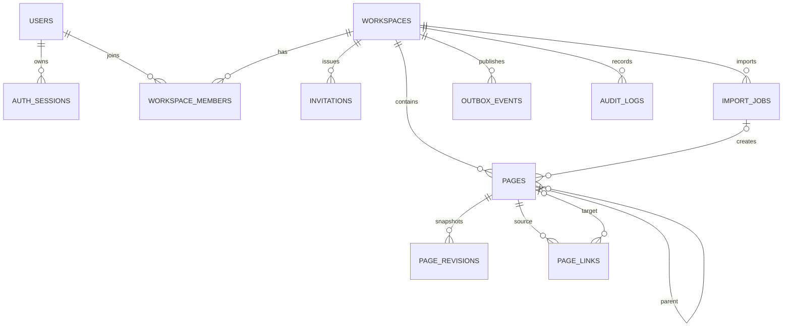

# 数据模型

所有业务实体使用 36 字符 UUID，时间列使用带时区时间。`backend/migrations/versions/0001_initial.py` 是显式、可回退的初始迁移；应用启动不会执行 `create_all`。

v0.3新增可逆迁移`0002_page_tree_order`，为页面增加`(workspace_id,parent_id,deleted_at,title,id)`复合索引。目录仍使用Page，目录导入项目键为`dir:规范路径`；没有新增目录表或业务字段，进度只统计Markdown文件。

| 表 | 主要字段与约束 |
| --- | --- |
| users | 唯一 email、name、Argon2 password_hash |
| auth_sessions | user_id、expires_at、revoked_at；JWT jti 对应此表主键 |
| workspaces | name、created_by；写操作用行锁协调页面树和链接 |
| workspace_members | 唯一 `(workspace_id,user_id)`；角色限定 owner/admin/editor/viewer |
| invitations | token_hash 唯一，绑定 email、role、expires_at、accepted_at；不存明文 token |
| pages | workspace_id、parent_id、title、content、JSON tags、version、deleted_at、创建/更新人；version > 0 |
| page_revisions | 唯一 `(page_id,version)`；完整 title/content/tags/parent/deleted 快照 |
| page_links | source_id、target_id、raw_target、state、source_version |
| import_jobs | 唯一 `(workspace_id,idempotency_key)`；payload/result JSON、total/processed、attempts、error |
| outbox_events | kind、payload、published_at、attempts；待发布事件与 Job 同事务 |
| audit_logs | workspace_id、actor_id、action、entity_id、details、created_at |

数据库级租户约束：

- Page 的 `(workspace_id,parent_id)` 引用同空间的 Page `(workspace_id,id)`。
- PageRevision 的 `(workspace_id,page_id)` 引用同空间 Page。
- PageLink 的 `(workspace_id,source_id)`、`(workspace_id,target_id)` 都引用同空间 Page。
- Page 的 `(import_job_id,import_item_key)` 唯一，防止重复任务重复创建页面。

关键索引包括成员 `(user_id,workspace_id)`、页面 `(workspace_id,deleted_at)`、页面 `(workspace_id,title)`、链接 `(workspace_id,target_id)`、审计 `(workspace_id,created_at)`、Outbox `(published_at,created_at)` 与全文 GIN 索引。全文 `search_vector` 只由数据库维护，不由浏览器或业务代码写入。

页面删除是软删除。删除和恢复都会增加版本并留下修订；历史回滚创建一个新版本，不覆写旧快照。空间和账户物理删除没有公开接口。

