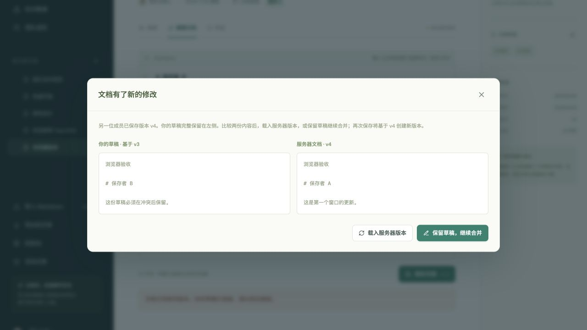
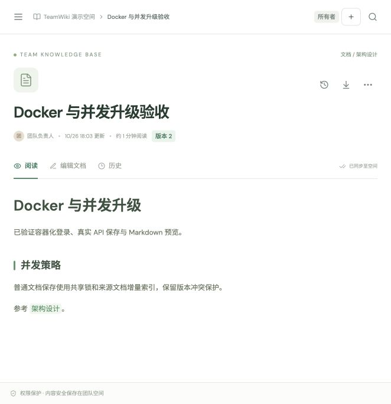

# 验证记录

首版记录保留如下；0.2.0 升级及本次 Docker、并发验证见文末。

记录日期：2026-10-26。以下是本次实际执行的结果；硬件、数据规模和运行方式仅代表当前本机开发环境。

## 首版原生基础服务（0.1）

- macOS arm64；Python 3.12 虚拟环境。
- PostgreSQL 17.11：从 PostgreSQL 官方源码编译到项目 `work/runtime/pgsql`，数据也在项目 `work/` 中；仅监听 `127.0.0.1:55432`。初始化所需共享内存权限通过自动权限审核后正常创建。
- Redis 7.4.7：从官方源码编译到项目 `work/runtime/redis`，仅监听 `127.0.0.1:56379`；实际 `PING` 返回 `PONG`。
- Postgres.app 下载包 SHA-256 与发布值匹配，但该下载方案触发 macOS 应用校验而未能运行，因此已放弃。没有绕过 Gatekeeper、移除隔离属性或修改系统安全设置，后续测试全部使用本地编译的 PostgreSQL 命令行程序。
- 本机未安装 Docker；Compose 文件和镜像构建配置已提供，但本次没有执行容器镜像构建或容器启动。

## 数据库迁移

对可丢弃的 `teamwiki_migrationcheck` PostgreSQL 数据库依次执行：

```text
alembic upgrade head     PASS
alembic downgrade base   PASS
alembic upgrade head     PASS
alembic upgrade head --sql   PASS
```

主开发库和独立测试库也完成了 `0001_initial` 升级。查询系统目录确认：

- `pages.search_vector` 为 `tsvector`、`GENERATED ALWAYS ... STORED`，使用 `simple` 配置，标题 A / 正文 B 权重。
- `ix_pages_search_vector` 是 GIN 索引。
- 页面父节点、修订记录、链接来源与目标具有包含 `workspace_id` 的复合外键。
- `(workspace_id,user_id)`、`(page_id,version)`、导入幂等键与导入项目键的唯一约束存在。

脚本及迁移通过显式 `backend/pyproject.toml` 配置下的 Ruff 检查和 Python 编译检查。

## 后端回归与本次修复

最终后端套件在真实 PostgreSQL 测试库运行，**44 项通过**。覆盖会话撤销、来源检查、角色限制、跨空间 IDOR、页面竞争写入、修订恢复、链接状态、全文搜索、导出、缓存降级、危险 ZIP、任务幂等、失败回滚和恢复锁顺序。测试只清空独立测试库业务表。

审查中发现并修复了两项问题：

- Markdown 代码片段识别中的复杂正则可能在恶意分隔符输入上耗时过长；改为线性扫描，并加入未闭合围栏、不同长度反引号及对抗输入的回归测试。
- 导入恢复任务的锁顺序与消费任务不同；在真实 PostgreSQL 中复现了空间外键相关的死锁后，统一为先锁空间、再锁任务，并在取得锁后重新判断状态，回归测试验证并发完成不会被恢复任务误覆盖。

## 真实 Redis 缓存检查

对单独验证空间执行真实 HTTP 请求和 Redis 读写，四项均通过：首次读取确实填充缓存、更新后旧键驱逐、延迟旧版本回填不影响当前版本读取、软删除后即使缓存仍在也拒绝读取。观测结果见 [缓存检查 JSON](verification-artifacts/live-cache-smoke.json)。这项检查补充了套件中的模拟故障和权限测试。

## API 演示数据

`scripts/seed.py` 通过真实 HTTP API 成功创建四个角色账户与四篇中文样例文档。再次运行成功复用账户、空间和原有文档。性能测试创建的临时页面已通过 API 软删除；四篇原始样例保留，浏览器验收另创建了一篇测试页面。

## 真实 Worker 与 Beat 导入

API 使用本机 PostgreSQL / Redis；Celery Worker 为本机 `solo` 单进程，Beat 实际每 5 秒触发 Outbox Dispatcher。Compose 中的 Worker 默认使用两个进程；这次没有验证该容器运行模式。

在独立的 “Import integration verification” 空间执行并观察到：

1. 上传 UTF-8 Markdown，返回 HTTP 202 和 queued Job。
2. 同一个 `Idempotency-Key` 再次上传，返回相同 Job ID。
3. Beat 发布 Outbox，真实 Redis broker 将任务交给 Worker，Job 最终 completed，`processed=1,total=1`。
4. Outbox `published_at` 非空，`attempts=1`。
5. 通过真实 broker 再投递同一个 Job 两次，两次均返回 completed；空间仍只有一篇导入页面，版本仍为 1。

观察到的 Job ID：`69b37f6f-8a50-487c-885c-dd3493f52a6d`。结果保存为 [导入观测 JSON](verification-artifacts/import-smoke.json)。这个检查验证一次正常发布和重复消费；进程被强制终止时的恢复行为还需结合后端测试与更长时间的故障演练评估。

## Locust 本机短时检查

运行命令：

```bash
.venv/bin/locust -f scripts/locustfile.py --headless -u 10 -r 2 -t 30s \
  --host http://127.0.0.1:8000 --csv work/locust --only-summary
```

一个 Uvicorn 进程、本机 PostgreSQL/Redis、四篇初始样例文档；10 个虚拟用户，每秒增加 2 个，配置 30 秒。任务混合登录、读取、搜索、图谱、保存和旧版本保存。

| 指标 | 实际观察 |
| --- | --- |
| 完成请求 | 991 |
| 失败 | 0 |
| 最终统计请求速率 | 35.53 请求/秒 |
| 中位数 / P95 / P99 | 6 / 12 / 39 ms |
| 成功保存 | 103 |
| 验证到预期 409 的旧版本保存 | 103 |

预期的 409 被脚本明确检查后记为成功，不能将 0 失败理解为没有并发冲突。原始最终控制台摘要保存在 [Locust 结果](verification-artifacts/locust-summary.txt)。周期 CSV 最后一次刷新为 956 请求，先于退出时的 991 请求；本表使用退出摘要。此次数据量很小、耗时很短，仅是本机功能和延迟观测，不能用于生产容量承诺。

## 全文索引执行计划

四篇样例文档的真实查询自然选择空间 B-tree 索引，再过滤全文向量，执行时间约 0.026 ms；小表不必使用 GIN。

另在可丢弃的迁移校验库插入 20,000 篇无业务敏感数据的合成页面，同一空间中每 1,000 篇含一个稀有词 `quasar`，执行 `VACUUM ANALYZE pages` 后运行与 API 相同的完整字段查询、`websearch_to_tsquery('simple', ...)` 过滤、排名和排序。优化器自然选择：

```text
Bitmap Heap Scan on pages
  Recheck Cond: (search_vector @@ '''quasar'''::tsquery)
  -> Bitmap Index Scan on ix_pages_search_vector
       Index Cond: (search_vector @@ '''quasar'''::tsquery)
```

返回 20 行，观察到 Planning Time 0.691 ms、Execution Time 0.107 ms。未关闭顺序扫描，未强制索引。完整计划见 [20,000 页 EXPLAIN](verification-artifacts/explain-search-20k.txt)。这是合成数据上的一次热缓存查询，只验证索引存在且可被实际查询利用。

## 依赖复现

`backend/requirements.lock` 固定 54 个运行依赖，`backend/requirements-dev.lock` 固定 89 个运行及开发依赖；运行依赖版本在两份锁文件中一致，其中 SQLAlchemy 固定为 2.0.55。Docker 安装运行锁文件，CI 安装开发锁文件，再以 `--no-deps` 安装应用。前端使用 `package-lock.json` 和 `npm ci`。

最终代码完成后已重启 API、Worker 和 Beat，确认 SQLAlchemy 2.0.55；`/api/ready` 返回数据库和缓存均 ok，重启后的 Worker 通过真实 broker 再次消费已完成 Job 后仍返回 completed。`/api/docs`、`/api/redoc` 和 `/api/openapi.json` 均可通过同源 `/api` 路径访问；[OpenAPI 快照](openapi.json) 从该最终服务导出，包含 25 个路径。

## 首版验证边界与后续状态

- 首版未执行的 Docker / Compose 镜像构建与容器联调，已在0.2升级中完成。
- 生产 TLS、跨主机负载、持久化存储故障和长期容量测试。
- GitHub Actions 的远程执行；CI 配置已提交为可运行工作流，远程结果需由仓库运行确认。


## 前端与浏览器验收

Node 26 本机执行 `npm run typecheck`、`npm test`、`npm run build` 均成功；5个测试文件共13项通过。生产构建没有分块大小警告；`npm audit` 观察到0项已知依赖漏洞（仅代表本次查询）。最低工具链 Node22.12+，CI和Docker使用Node22。

通过真实浏览器对127.0.0.1:5173执行：Owner登录→新建文档及标签→CodeMirror输入→保存v2→Markdown预览与标题链接→历史版本1恢复成v3→双窗口从v3开始编辑→窗口A保存v4→窗口B收到409比较界面，草稿完整保留→保留草稿继续合并→保存v5。重载后验证目录定位的DOM目标、全文搜索FastAPI并打开结果、Backlinks、5节点6边知识图谱、成员角色页面、登出及Viewer只读界面；Viewer文档加载后没有编辑/新建按钮，后端拒写由API测试验证。

浏览器验收发现React StrictMode下标题锚点使用渲染计数会错位，已改成源文本行号；新增实际DOM回归测试。另有集成测试验证单页路由离开再返回仍保留草稿和编辑基准版本。




最终复核：在backend目录按CI方式运行，44项通过（3.42秒）；前端13项通过（5文件），tsc类型检查与Vite生产构建通过。SQLAlchemy2.0.55下再次在独立迁移校验库执行downgrade base→upgrade head通过。Ruff和compileall通过，pip check未发现依赖冲突。


## 0.2.0 Docker 与并发升级（2026-10-26）

本次从干净0abea29基线开发，完整 PostgreSQL/Redis 后端回归为77项通过，Ruff检查通过。新增范围包括共享/排他工作区锁、单来源链接索引、权限撤销竞态、连接池等待、慢SQL与锁超时、过载503、原生数据库连接拒绝503、Redis连接复用/生命周期/无响应、并发冷缓存合并、热缓存绕过填充锁、两进程指标聚合和基准统计校验。

实际 Docker Engine、Compose和持久化VM完成后端/前端镜像构建、完整栈启动与迁移、真实Worker/Beat异步导入、版本冲突、跨租户拒绝、缓存中断降级、队列重启后的排队任务恢复。指标在两个API进程间聚合，入口不公开内部指标；Nginx认证限流产生429，后端非root运行。远程GitHub Actions尚未执行，新CI容器任务已按同一套本机已执行命令配置。

同条件短测：100篇248字节初始正文、每页一条链接，16请求流，2API进程，池5+10，读/写分别10秒。不同文档保存136.390→764.940请求/秒，P95 138.778→32.144毫秒；读取738.892→753.711请求/秒。两边均5个热点胜者、75个预期409，修订连续。部署默认池为5+5，与刻意匹配旧默认的基准池不同。数据规模、时长、同机闭环负载限制和原始JSON详见 [并发验证](concurrency.md)。

独立审查发现数据库连接建立可能直接抛出ConnectionRefusedError，容器停止时还可能抛出socket.gaierror，绕过原SQLAlchemy异常分类而返回500。已用真实关闭端口复现，并补齐仅针对网络连接/建立超时的503处理；本地文件错误与SQL编程错误不被伪装成容量问题。


最终在0.2.0容器实际停止PostgreSQL，readiness与连续三个已认证业务请求均返回503，携带Retry-After:1；重启后就绪和业务读取恢复200。持久VM迁移保留已有账户、样例空间和导入任务。脱敏观测记录见 [Docker升级证据](verification-artifacts/docker-v0.2.json)。

最终本机复核：真实PostgreSQL/Redis套件77项通过（4.88秒），前端13项测试、类型检查与生产构建通过，独立迁移校验库upgrade/downgrade/upgrade通过。部署无新数据库字段，沿用显式0001迁移。


容器正式构建的浏览器验收暴露出首版手工Rolldown分块造成的循环导入，打开文档时出现`u is not a function`。已删除强制分组，保留默认懒加载；新增直接执行编译入口、文档模块、真实CodeMirror和预览的DOM回归，先复现失败再验证修复。Docker Node22镜像构建和CI均运行`npm run test:production`。默认编辑器分块约618KB的大小提示保留，优先保证产物执行正确，尚未据此声称首屏或网络加载已优化。

修复后的真实Docker浏览器已通过Owner登录、阅读、新建子文档、编辑、保存v1→v2、Markdown预览、Wiki链接和5节点5边图谱验收。完整容器使用独立数据库卷，原生开发数据库未修改。




0.2依赖锁新增prometheus-client0.26.0：运行依赖55个，运行及开发依赖90个，SQLAlchemy仍固定2.0.55。当前未验证AMD64镜像和远程GitHub Actions；生产TLS、跨主机故障与长期容量验证仍需在目标环境完成。
